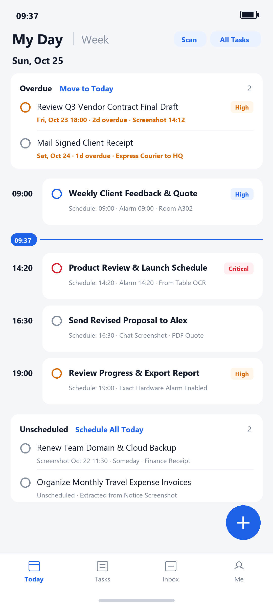
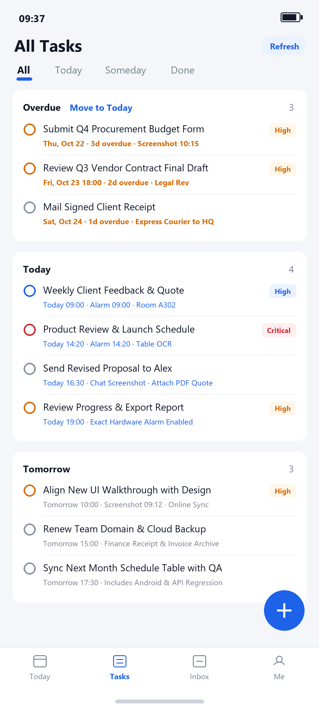

<div align="center">
  
  <h1>Pai2do (慧记事)</h1>
  <p><strong>Turn Screenshots, Schedule Tables & Voice into Exact-Alarm Daily Tasks</strong></p>
  <p>
    <em>250KB Pure Native Android App · Zero Third-Party SDKs · Local-First & BYOK (Google Gemini Free Tier / OpenRouter / OpenAI)</em>
  </p>
  <p>
    <a href="https://raw.githubusercontent.com/shrorse-ai/pai2do/main/releases/pai2do-0.8.9-preview.apk"></a>
    
  </p>
  <p>
    <a href="#-english-overview">English Overview</a> ·
    <a href="#-quick-ai-setup-no-phone-number-or-subscription-needed">Free Gemini Key Setup</a> ·
    <a href="#-中文说明--慧记事国内版">中文说明 (慧记事)</a>
  </p>
</div>

---

## 🌍 English Overview

Most task managers today are 100MB+ wrappers charging $10/month subscriptions, while our real daily tasks are trapped inside **chat screenshots, event flyers, spreadsheet photos, or quick voice notes**.

**Pai2do** is an ultra-lightweight (**~250 KB**), privacy-first native Android utility written from scratch in pure Java with **zero third-party UI, analytics, or ad libraries**.

### ✨ Key Features

1. **📸 Screenshot, Schedule Table & Photo to Tasks (AI Vision OCR)**
   - Import chat screenshots, meeting notices, or multi-row schedule tables.
   - Extracts both **complete editable OCR text** and **structured actionable tasks**.
   - Automatically recognizes start/end time ranges (e.g., `Nov 1, 15:00-17:00`) and defaults the reminder alarm to the start time.
   - Side-by-side original screenshot preview with full-screen pinch-to-zoom for instant verification.

2. **🎤 Hold-to-Speak Voice to Task (16kHz PCM + Smart Structuring)**
   - Hold the microphone button to speak naturally (e.g., *"Remind me tomorrow at 3:30 PM to send the Q4 proposal to Alex, and include last week's pricing sheet"*).
   - Automatically transcribes and splits your speech into a clean **Task Title**, **Detailed Notes**, **Priority**, and **Calculated Reminder Time**.

3. **⏰ Hardware-Exact Alarms (`AlarmManager.setAlarmClock`) & Zero Battery Drain**
   - **Zero background polling**: Does not run background timers or drain battery while idle.
   - Uses Android's hardware RTC clock wake-up (`setAlarmClock` + `setExactAndAllowWhileIdle`) to break through deep Doze mode and fire on the exact minute.
   - Includes **synthesized 16-bit PCM WAV chimes** generated on-device (Crisp Chime, Gentle Marimba, Bright Bell, Urgent Alarm) plus custom MP3/WAV ringtone support.

4. **📊 Evidence-Based Work Reports**
   - Generate Daily, Weekly, or Monthly work reports directly from your completed and in-progress tasks—never fabricates unrecorded work.

5. **🔒 100% Local-First & Bring-Your-Own-Key (BYOK)**
   - Works offline out of the box as a fast local SQLite task & alarm manager.
   - **Your API Key stays on your phone**: Encrypted via hardware-backed `AndroidKeyStore` (`AES-256-GCM`). AI requests connect directly from your device to your chosen provider.
   - **Original screenshots never leave your device**.

---

## 📱 Screenshots

<div align="center">
  
  &nbsp;&nbsp;&nbsp;
  
</div>

---

## 🚀 Quick AI Setup (No Phone Number or Subscription Needed)

Pai2do automatically adapts to your system language (or you can switch anytime in **`Me → Language & Region`**). In **Global / English Mode**, Pai2do includes built-in presets for phone-free global AI providers:

| Provider | Sign-In Method | Free Tier / Pricing | Recommended Model |
| :--- | :--- | :--- | :--- |
| **Google Gemini (Recommended)** | Google Account at [aistudio.google.com/apikey](https://aistudio.google.com/apikey) | **Free Tier available** (No phone number or credit card required) | `gemini-2.5-flash` |
| **OpenRouter (Global)** | Google / GitHub / Email at [openrouter.ai/keys](https://openrouter.ai/keys) | Free & Pay-as-you-go global models | `google/gemini-2.5-flash` / `qwen/qwen3-vl-32b-instruct` |
| **OpenAI Official** | OpenAI Account at [platform.openai.com/api-keys](https://platform.openai.com/api-keys) | Pay-as-you-go | `gpt-4o-mini` |

### 3 Steps to Connect Google Gemini for Free:
1. Open [Google AI Studio API Keys](https://aistudio.google.com/apikey) and sign in with your Google account.
2. Click **"Create API key"** and copy the key (`AIza...`).
3. In Pai2do, go to **`Me → AI OCR & Reports`**, select **`Google Gemini (Free)`**, paste your key, and tap **`Verify & Save`**.

---

## 📥 Download & Verification

- **Latest Version**: `v0.8.9` (`versionCode 53`)
- **Direct APK Download (GitHub Raw)**: [https://raw.githubusercontent.com/shrorse-ai/pai2do/main/releases/pai2do-0.8.9-preview.apk](https://raw.githubusercontent.com/shrorse-ai/pai2do/main/releases/pai2do-0.8.9-preview.apk)
- **GitHub Releases**: [https://github.com/shrorse-ai/pai2do/releases](https://github.com/shrorse-ai/pai2do/releases)
- **Minimum Android Version**: Android 8.0+ (API 26+)
- **Package Size**: `271,816 bytes` (~265 KB)
- **SHA-256 Checksum (`v0.8.9`)**:
  ```text
  059589f3a0d5d399728d2eca12dc1c0cbcad580c11996f85097b3b0f49b22b52
  ```

---

## 🇨🇳 中文说明 · 慧记事（国内版）

**「慧记事 (Pai2do)」** 是一款安装包仅 **265 KB** 的纯原生 Android 待办与日程提醒工具，支持根据手机系统语言自动切换 **中文（国内版）** 与 **English（海外版）**，也可在 **「我的 → 语言与地区 / Language」** 中手动切换。

### 核心亮点
- **截图 / 表格 / 照片转待办**：导入微信群聊截图、排期表、会议通知照片，自动提取完整原文与多条子任务，智能识别起止时间段（默认以开始时间作为提醒时间），支持原图双指缩放对照核对。
- **按住说话语音记事**：16kHz 原生录音转文字，自动提炼「任务标题」、「详细说明」、「重要程度」并换算具体提醒时间一键填表。
- **硬件级准点闹钟唤醒 (`setAlarmClock`)**：平时后台零轮询、零联网、几乎零耗电；到点依托系统底层硬件时钟唤醒，内置 4 款免流合成清脆铃声并支持自定义手机音乐。
- **国内 / 海外双模式 AI 预置**：
  - **中文（国内版）**：预置 **硅基流动 (SiliconFlow)** 三步引导，默认搭配高性价比视觉模型 `Qwen/Qwen3.6-35B-A3B` 与免费语音模型 `FunAudioLLM/SenseVoiceSmall`。
  - **English（海外版）**：自动隐藏硅基流动，预置免手机号的 **Google Gemini (Google AI Studio 免费额度)**、**OpenRouter** 与 **OpenAI**。
- **本机优先与隐私安全**：无任何遥测埋点或第三方服务器关联；原图与待办仅保存在手机本机私有目录；API Key 经由系统硬件 `AndroidKeyStore` (`AES-256-GCM`) 加密存储于本机，不上传任何服务器。

### 下载安装
- **直接下载 APK (`v0.8.9`)**：[https://raw.githubusercontent.com/shrorse-ai/pai2do/main/releases/pai2do-0.8.9-preview.apk](https://raw.githubusercontent.com/shrorse-ai/pai2do/main/releases/pai2do-0.8.9-preview.apk)
- **GitHub Releases**：[https://github.com/shrorse-ai/pai2do/releases](https://github.com/shrorse-ai/pai2do/releases)

---

## 📄 License & Disclaimer

Free for personal productivity, learning, and technical research. Reminders rely on device OS alarm permissions; for critical events (flights, exams, medication, contracts), always set your phone's built-in system clock alarm as a backup.
